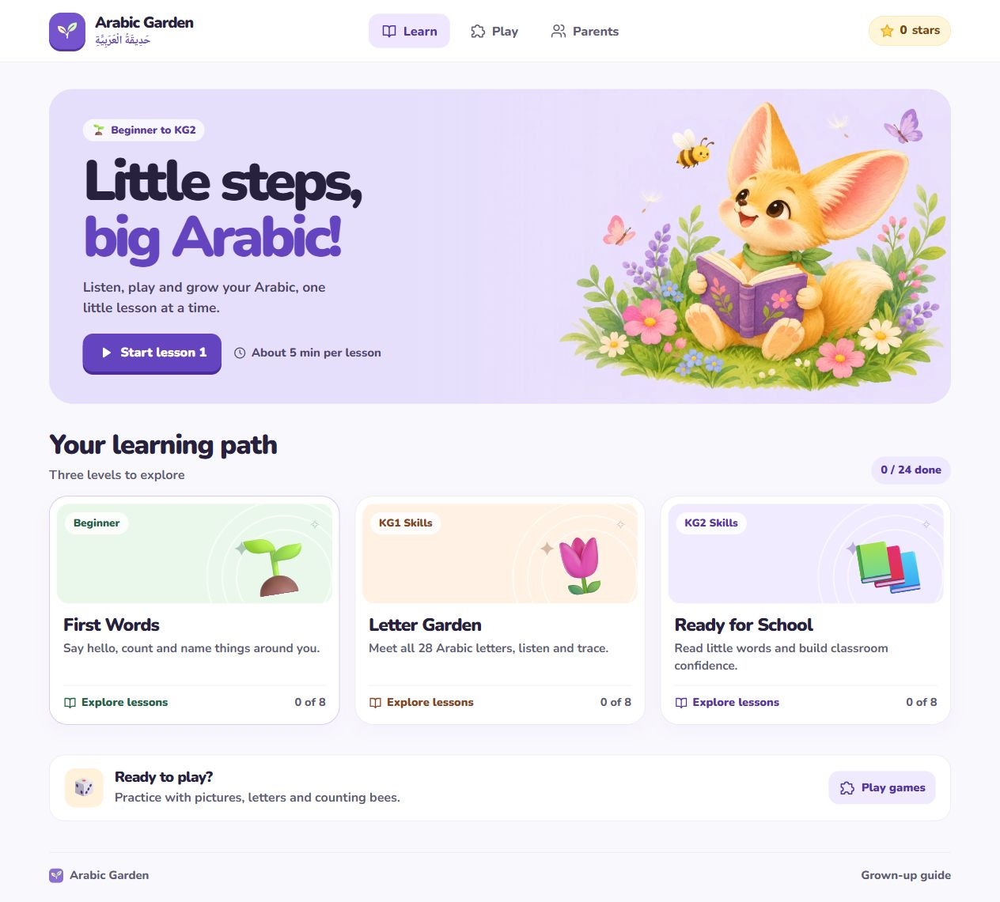
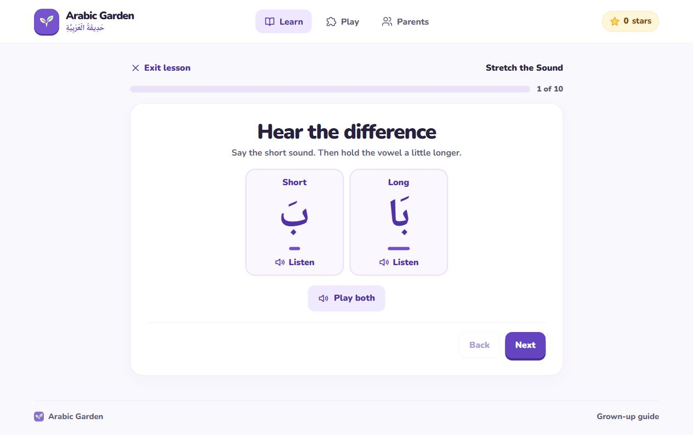

# Arabic Garden

Arabic Garden is a browser-based **Modern Standard Arabic (فُصْحَى)** learning app for young beginners. It guides children from their first greetings through KG2-level Arabic practice in short, interactive lessons.

**[Launch the live demo](https://aniqadev-del.github.io/arabic-garden-public/)**

## Screenshots

### Learning path



### Short and long vowel practice



## Features

- **24 lessons across three stages.** Begin with everyday words, learn all 28 Arabic letters, and practice joined forms, simple reading, and classroom phrases.
- **118 bundled audio clips.** Hear Modern Standard Arabic vocabulary and compare short and long vowels using native-speaker recordings.
- **Three practice games and finger tracing.** Match pictures, recognize letters, count in Arabic, and trace letter shapes with a finger or mouse.
- **Progress and a parent checklist.** Resume lessons, earn stars, and mark early Arabic skills observed during play. Progress stays in the current browser.

## Technologies

| Area | Technology |
| --- | --- |
| Interface | HTML5, responsive CSS, and vanilla JavaScript modules |
| Interactions | Canvas and Pointer Events for tracing, browser audio playback, and `localStorage` for progress |
| Audio tooling | Node.js, Python, NumPy, and ONNX Runtime |
| Hosting | GitHub Pages serves `docs/` from the `main` branch |

## Run locally

With Python 3 installed, run this from the repository root.

```sh
python -m http.server 8000 --directory docs
```

Open `http://localhost:8000` in your browser. The app uses the bundled audio and fonts.

## Curriculum and audio maintenance

The curriculum is in `docs/curriculum.js`. To refresh its audio, use Node.js 22 or later and Python with `numpy` and `onnxruntime`. Download the ONNX checkpoint and put the three files from the `tiny_voca_ar` front end in a directory of that name on `PYTHONPATH`. The curriculum provides the diacritics, so a separate diacritization model is unnecessary. [Model checkpoint](https://huggingface.co/oddadmix/tiny-voca-arabic/tree/30da3c1/onnx) · [Arabic front end](https://huggingface.co/spaces/oddadmix/tiny-voca-arabic/tree/main/tiny_voca_ar)

Download the Arabic Speech Corpus ZIP and run `node scripts/generate-audio.mjs <python-executable> <model.onnx> <arabic-speech-corpus.zip>`. The renderer takes each vowel pair from the same studio recording and adjusts the vowel to 120 ms and 240 ms while retaining the consonant onset and pitch. [Arabic Speech Corpus download](https://en.arabicspeechcorpus.com/)

## Credits

- The learning path takes guidance from the [UAE Ministry of Education’s non-native Arabic KG1 and KG2 outcomes](https://www.moe.gov.ae/en/guides/Documents/Mandatory%20subjects/Performance-Levels-for-Mandatory-Kindergarten-Subjects-in-Private-Schools-En.pdf). It covers selected Arabic skills for home practice.
- General lesson audio is synthesized with oddadmix’s Modern Standard Arabic model. [tiny-voca-arabic](https://huggingface.co/oddadmix/tiny-voca-arabic)
- Vowel audio uses excerpts of Nawar Halabi’s Arabic Speech Corpus, edited for duration and level. [Arabic Speech Corpus](https://en.arabicspeechcorpus.com/) · [CC BY 4.0](https://creativecommons.org/licenses/by/4.0/)
- Nunito and Noto Naskh Arabic are supplied under their accompanying SIL Open Font Licenses in `docs/fonts`.
- The fennec fox illustration was generated with ImageGen.

<details>
<summary>Illustration prompt</summary>

  > Use case illustration-story. Create a single landscape 3:2 hero illustration for a premium whimsical preschool Arabic-learning web app called Arabic Garden (do not draw any text or letters). Composition: a big adorable golden sand baby fennec fox with enormous soft pointed ears, cherry pink inner ears, round black eyes and rosy cheeks, wearing a small sage-green neckerchief, sitting at the right-of-center holding open a violet picture book, looking up at a tiny hovering bumblebee. A vivid patch of spring greens, flowering pink and ivory daisies, lilac and blue wildflowers and leaves forms a layered little miniature garden around it, a couple of floating white seed puffs and butterflies. Both the fox and its book should fit in the middle-right 75% of the image, with only softly diffused pale lavender empty space all around the image edges and noticeably more empty space on the left for a fade into UI. Soft plain pale lilac background exactly around #ebe6ff, no horizon, no panel edge. Bespoke hand-painted storybook illustration with beautiful simplified shapes, faint paper texture, clean silhouettes, bold greens, golden oranges and lavender accents. Charming, airy, gentle, sophisticated and immediately legible at small scale. No text, no numbers, no lettering, no logo, no frame, no typography, no humans.

</details>
